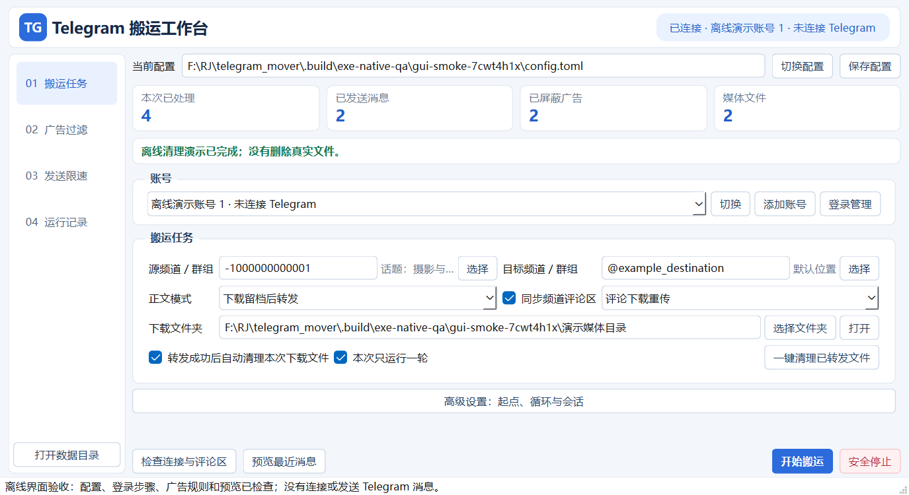
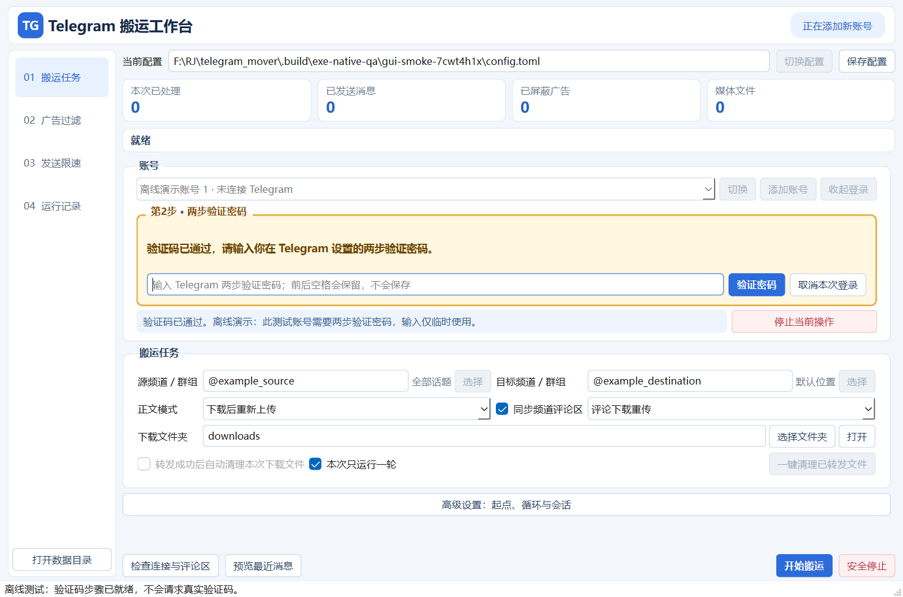
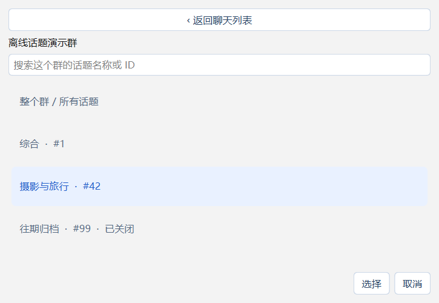
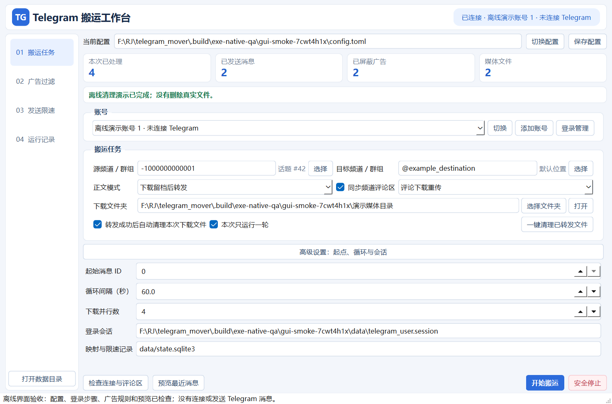
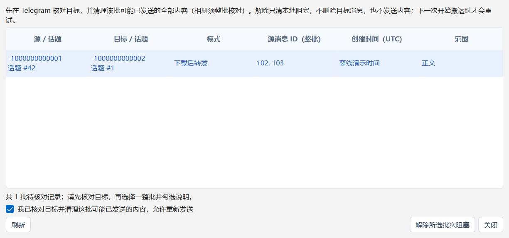

# Telegram 搬运工作台 · 软件说明书

适用版本：0.1.0。本文面向 Windows 图形界面用户。源码运行、配置字段和接口实现见 [技术说明](TECHNICAL.md)。

## 目录

1. [安装和首次启动](#安装和首次启动)
2. [登录和切换账号](#登录和切换账号)
3. [创建搬运任务](#创建搬运任务)
4. [正文与评论模式](#正文与评论模式)
5. [话题群和频道评论](#话题群和频道评论)
6. [广告过滤](#广告过滤)
7. [下载目录与速度](#下载目录与速度)
8. [清理已转发文件](#清理已转发文件)
9. [限速与安全停止](#限速与安全停止)
10. [增量、备份和更新](#增量备份和更新)
11. [异常与待核对发送](#异常与待核对发送)
12. [功能边界](#功能边界)

## 安装和首次启动

在仓库的 [Releases](https://github.com/HuanTing1999/telegram-mover/releases) 下载 Windows x64 压缩包，完整解压到可写目录，再双击 `TelegramMover.exe`。无需安装 Python。不要直接在压缩包里运行，也不要把程序放在没有写入权限的系统目录。

发布包应包含 EXE、无凭证配置模板、使用说明和许可文件；从 GitHub 的“Code → Download ZIP”取得的是源码，需要按 README 安装 Python 依赖。

首次运行会使用 EXE 旁的 `config.toml`。切换配置后，相对数据路径以**所选配置文件所在目录**为准。保存设置前看清主界面“当前配置”。已有配置不会被自动覆盖。

软件分为“搬运任务、广告过滤、发送限速、运行记录”四页。下面截图为离线演示，展示的账号和内容均为测试占位。

## 登录和切换账号

### 一次性应用设置

Telegram 的 MTProto 用户客户端需要一套 API_ID 和 API_HASH。请在 [my.telegram.org/apps](https://my.telegram.org/apps) 自行申请，填入“应用设置”后保存；也可设置系统环境变量 `API_ID`、`API_HASH`，环境变量优先。

API_ID 填正整数，API_HASH 填对应的32位字符串。开源代码与默认发行包不含共享应用密钥，也不会自动申请或生成这些凭证。

**应用凭证由同一款软件共用，不是每个 Telegram 账号一套。** 完成一次设置后，添加其他手机号无需重新申请。已配置时应用设置自动折叠。

### 手机号、验证码和两步验证

1. 输入含国际区号的手机号，例如 `+63…`、`+1…`、`+44…` 或 `+852…`；软件不限定 `+86`，不自动补国家码。
2. 点击“发送验证码”，看账号区域返回的状态和实际发送渠道。
3. 去对应账号已登录的 Telegram 官方客户端或手机短信查收。渠道由 Telegram 决定，不保证一定发送短信。
4. 输入验证码，按回车或点击“验证并登录”。
5. 若显示黄色的“第2步 · 两步验证密码”，填写你在 Telegram 设置的密码。此时手机号和验证码区会收起，无需重新取码或等待验证码倒计时。

验证码输错后可重新填写；服务器允许时可点“重新获取验证码”。重发倒计时只针对本软件当前请求，不一定与官方客户端另一请求一致。取消、过期或连续错误会结束本次挑战；服务器冷却仍会保留，重启软件不会解除。

密码按原样提交，前后空格也属于密码。手机号、验证码和两步验证密码不写入任务配置；成功后只保存授权 session。session 本身包含账号授权，应像密码一样保管。忘记两步密码请使用 Telegram 官方恢复流程。

### 恢复和换号

有效会话可点击“恢复已有会话”，下次无需重复验证码。添加另一个账号用“添加账号”，已有账号从下拉列表选择后点击“切换”。每个账号独立保存会话，切换不删除原账号授权。

登录成功后只显示紧凑账号栏；需重新登录时点“登录管理”。运行任务或正在验证时，先安全停止或取消，再换号。详细凭证来源与账号文件说明见 [多账号说明](../ACCOUNTS.md)。

## 创建搬运任务

1. 在“搬运任务”选定已登录账号。
2. 点击源旁的“选择”，从该账号可见频道/群组中搜索；同名聊天按 ID 区分。也可填写 `@username`、`t.me/…` 链接或数字聊天 ID。
3. 用相同方式选目标。目标频道需有发帖权限，目标群需有发送权限。
4. 选择正文模式，按需勾选评论同步并选择评论模式。
5. 选择下载文件夹，检查广告规则和发送限速。
6. 先点“检查连接与评论区”，再“预览最近消息”；这两步不会发送或推进同步进度。
7. 确认后点“开始搬运”，观察状态卡、统计与运行日志。

首次建议使用自己管理的小型测试频道验证。软件不会自动入群、提权或改变频道设置。

**完整帖子链接只识别所属聊天，不会自动把该帖子当成起点。** 起点在高级设置中配置，`起始消息 ID = 0` 表示首次从可见历史开始；其他值只处理比它大的消息。后续同时遵守已保存进度。

“本次只运行一轮”勾选后跑完本轮结束；未勾选时按配置的循环间隔检查。刚发布的消息和未稳定的尾部相册可能留到下轮，默认稳定等待为5秒。

## 正文与评论模式

| 界面模式 | 本地媒体 | 目标行为 | 适用情况 |
|---|---|---|---|
| 纯下载备份 | 保存 | 不发送 | 归档、审计 |
| 直接转发 | 不下载 | 保留原转发引用 | 源允许转发，希望快速搬运 |
| 下载后重新上传 | 保存并上传本地文件 | 无转发头，纯文字重新发送 | 需要重新发布有权使用的内容 |
| 下载留档后转发 | 先保存完整文件 | 仍转发原消息 | 留档并保留转发引用 |

下载留档后转发与重传不同：前者仍引用原媒体。重传使用本地文件上传，但 Telegram 可能做服务端去重；软件不保证独一文件 ID、搜索排名或搜索归属。

正文支持四种模式。**普通频道评论区只支持“评论下载重传”和“评论纯下载备份”**，当前 API 无法把原生直接转发附到普通频道的指定评论根。可用正文直接转发、评论重传的组合。

纯下载正文时，评论也应选择纯下载。否则配置会明确报错，不会暗中发送评论。

## 话题群和频道评论

### 群组里的多个话题

点“选择”后先选群，再选“综合、资源区、交流区”等具体话题。源可选整个群/所有话题；目标可选指定话题或默认位置。第二层确认前不会覆盖原选择，取消会保留配置。

源选“整个群”时，各话题消息按 ID 合并搬到所选目标位置，**不会自动创建并逐一对应复制目标话题结构**。需要一一对应时，分别配置源话题和目标话题运行；各范围独立记录进度。同群只允许两个不同的明确话题，避免把整个群复制回自身。

### 频道的评论区

频道评论实际位于关联讨论组。软件先查关联讨论组，再为每条帖子解析讨论根；目标频道也必须关联讨论组，否则会提前停止。

目标帖子成功后记录源帖子、目标帖子及目标评论根的映射。每轮也检查已记录旧帖的新评论，因此晚到的评论能增量同步。评论统一回复目标帖子根，不重建评论之间的多层回复树；重发作者是当前登录账号。

群组话题 ID 与频道评论根不是同一种编号。不要把评论根手工填成话题 ID。

## 广告过滤

“广告过滤”检查正文、媒体说明、文件名、隐藏链接、按钮文字和按钮链接。可配置：

- 关键词：如广告合作、付费推广等，可增删。
- 正则：适合稳定的推广文案格式；支持超时保护。
- 域名黑名单：匹配指定域及子域，避免误伤名称相似的域名。
- 全部链接或按钮拦截：适合要求更严格的来源，可能误伤正常内容。
- 白名单：关键词白名单可豁免自动规则；域名白名单只豁免“全部链接”规则。

先用“测试这段内容”离线试算，再预览最近消息查看原因。预览中也可“屏蔽所选消息/相册”，手动屏蔽优先于白名单。

相册任一成员命中会跳过整组，避免拆乱相册。默认规则作用于正文和评论，纯下载备份默认仍保留完整内容；可另行启用备份过滤。

命中后记录原因并推进该批增量进度；**修改规则不会自动补发已跳过的历史消息**。运行记录可查被屏蔽内容及原因。无图片/视频 OCR，不保证识别所有广告。规则优先级和示例见 [广告过滤说明](../AD_FILTERS.md)。

## 下载目录与速度

在主任务页点击“下载文件夹 → 选择文件夹”，可选择其他硬盘；“打开”查看当前实际路径。默认是当前配置目录下的 `downloads`。点“保存配置”或开始任务后持久保存设置。

“下载留档后转发”必须先把本条或整个相册媒体完整落盘，再转发。未完成文件以 `.part` 暂存；失败不记为完整下载。

高级设置里的“下载并行数”范围为1–8，默认4；1是普通单路。至少2 MiB、大小已知的普通文件采用受限分块并行读取，照片、小文件、未知大小及 CDN 媒体使用普通流程。写入按顺序进行并校验长度，不拆乱相册。

EXE 包含 cryptg 本地加解密加速，界面显示实际下载 MB/s。实际速度仍取决于网络、文件所在数据中心、Telegram 服务端和磁盘。多路不保证线性提速，也不会提高发送额度。

换目录只影响新消息及未完成下载，不会搬动旧文件或重跑完成消息。清理旧目录时，请先选回它。

## 清理已转发文件

“一键清理已转发文件”只处理**当前目录中由本工具登记、且已确认完成“下载留档后转发”**的媒体。

“转发成功后自动清理本次下载文件”默认关闭，仅在该模式下生效。自动清理只处理本次已成功转发的文件；手动清理可处理当前目录的历史合格文件。

以下内容会保留：未发送、发送失败、结果待确认、未登记、文件身份/内容变化、重传模式、纯备份模式，以及旧版缺少文件身份信息的记录。清理不删除目标消息、同步进度、映射、配额或 pending。被占用导致删除失败时可稍后再清理。

## 限速与安全停止

默认限速是本工具的保守策略，**不是 Telegram 官方安全阈值，也不能保证账号永不受限**。

| 项目 | 默认值 |
|---|---|
| 两次发送操作间隔 | 至少15秒 |
| 滚动60秒 / 1小时 / 24小时 | 20 / 200 / 1,000条 |
| 单次运行 | 最多200条、60分钟 |
| 显式读取请求间隔 | 至少1秒 |

正文和评论合并计数，相册按成员数计数；纯下载不消耗发送条数。在“发送限速”可调整间隔、配额及允许时段。

收到 FloodWait 或群慢速模式等待时，先保存截止时间再等待；重启仍受约束。账号反垃圾限制或冻结会持久停止，先在官方客户端核对后再按 [限速恢复说明](../LIMITS.md) 处理，不能通过重启清空。

点“安全停止”后，读取和等待可取消；正在发送的当前批次会等待确认并保存映射。普通发送最多90秒无确认、上传连续120秒无实际进度时停止并保留待核对记录。不要为了加速退出而反复强制结束程序。

## 增量、备份和更新

任务记录在 SQLite 中，按账号、源/目标、模式、评论设置和话题范围隔离。同一任务重跑只处理新增内容，旧帖的新评论也会检查。

**切换账号、源/目标、模式或话题范围可能建立独立任务，从起点重新处理。** 不要用换模式的方式随意重试结果不明的发送，也不要提高起点后误以为被跳过的消息已成功。

默认数据：

| 路径 | 用途 |
|---|---|
| `config.toml` | 当前设置，可能含应用凭证 |
| `data/*.session`、`data/accounts/` | 授权会话 |
| `data/accounts.json` | 账号显示信息与会话索引 |
| `data/state.sqlite3` | 消息/评论映射、游标、配额、拦截和下载审计 |
| 会话目录旁的 `auth_cooldowns.sqlite3` | 登录重发等待 |
| `downloads/` 或自选目录 | 本地媒体 |

备份前先安全停止并退出软件，再复制配置、整个数据目录和需要保留的媒体目录。备份只放在自己控制的存储中，不传到公开 GitHub。

更新时退出旧版，保留原配置、数据及下载目录，只替换程序和说明文件；不要把模板覆盖到已有配置。不要同时运行两个程序共用同一 session/数据库。

## 异常与待核对发送

状态卡显示当前步骤，按钮恢复后会保留完成或失败原因。读取中的“等待1秒：最小请求间隔”不代表已发送。统计为零时先检查：是否仅备份、无新增、起点过高、尾部相册尚未稳定、或全部被广告规则拦截。

| 提示 | 含义与处理 |
|---|---|
| `API_ID must be an integer >= 1` | 应用设置为空或不是整数；填写一次有效应用凭证，不是手机号国家码问题 |
| 两步验证密码 | 验证码已通过，输入账号设置的密码；不用再取验证码 |
| `AUTH_RESTART` | Telegram 要求重新开始授权；按提示稍后手动取码，别删除搬运数据库 |
| 无法识别聊天 / 无访问权限 | 用“选择”确认聊天；私有链接不能代替加入/访问权限 |
| `ChatForwardsRestrictedError` | 源启用保护内容，不能直接转发；请使用允许转发的源或联系源管理员 |
| `ChatWriteForbidden` / 缺少发帖权限 | 检查当前账号在目标的发送权限 |
| FloodWait / SlowMode | 等待服务端指定期限，重启不会清除 |
| 读取或下载超时 | 检查网络、源权限和磁盘；该次读取没有发送内容，已保存映射保留 |
| 发送结果无法确认 / pending | 可能已发出，先人工核对目标，再处理本地阻塞 |

### 处理待核对发送

网络断开可能发生在 Telegram 已接受发送、但本地尚未拿到目标 ID 时。软件保留整批 pending，防止盲目重发；这不是可以直接忽略的错误。

1. 打开“运行记录 → 待核对发送”。
2. 对照源/目标、话题、模式、整批源消息 ID 和 UTC 时间检查目标。
3. 若该批可能已发送，先人工清理目标对应整批内容；相册按整组核对。若确认完全未发出，也可继续下一步。
4. 选中记录，勾选已核对声明，再点“解除所选批次阻塞”。
5. 下次开始任务才会重新处理未完成部分。

解除只删除对应本地阻塞，不删除目标、不立即发送、不重置进度/配额。记录变化需刷新；部分映射不允许直接解除。未经核对解除仍可能造成副本。

## 功能边界

- 使用 MTProto 用户账号，不支持 Bot Token、扫码或第三方登录；两步验证必须按账号要求完成。
- 只处理当前账号有权读取和发送的内容；软件不会绕过保护内容、自动入群或变更权限。
- 普通频道评论不支持原生直接转发进指定线程；支持评论重传和备份。
- 重传不承诺独一文件 ID、搜索排名或归属；不保留原作者身份和原发布时间。
- 不同步编辑、撤回、反应、浏览数、成员名单；不复制完整话题结构或多层评论回复树。
- 投票、联系人、位置等非文件媒体无法像普通文件一样重传，会明确停止。
- 不提供图片/视频 OCR 或广告百分百识别承诺。
- 网络故障和服务端异步视频可能需要人工核对，不能承诺严格无重复的跨系统事务。
- 当前验证以离线模拟网络、真实 SQLite、Qt 窗口和协议契约为主；不是使用真实账号的完整 Telegram 验收。

仅搬运你有权访问和再发布的内容。项目与 Telegram 官方无隶属关系。遇到软件问题，请按 [贡献说明](../CONTRIBUTING.md) 提供脱敏复现信息。
